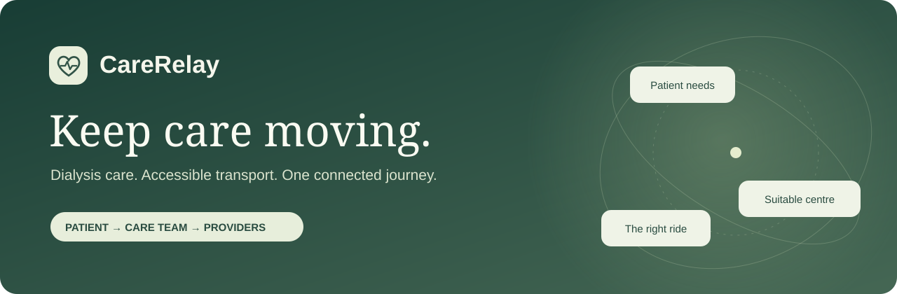
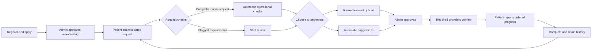
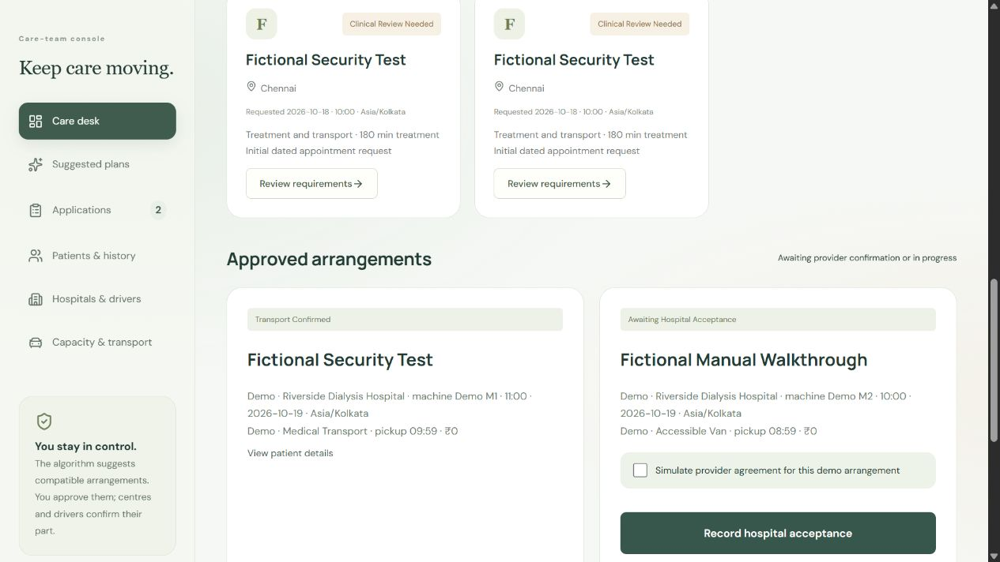
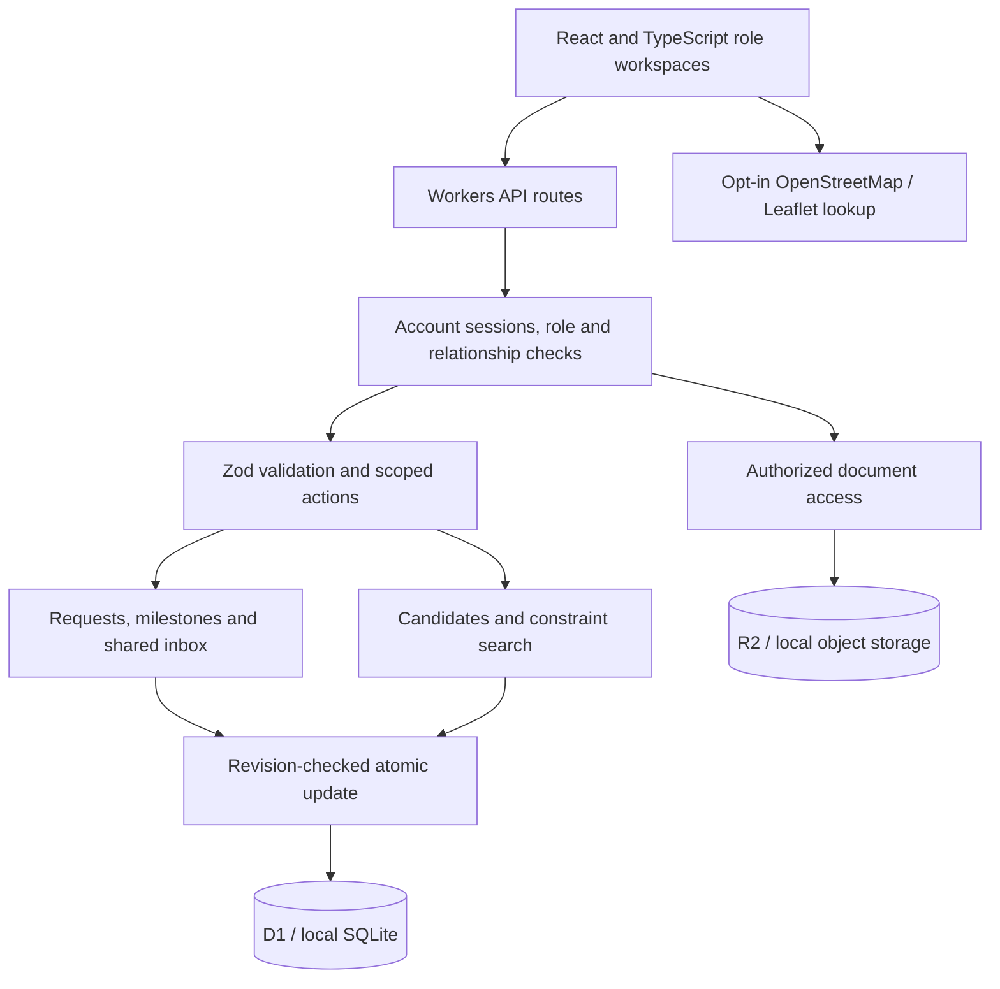

<p align="center"></p>
<h1 align="center">CareRelay · Baloon National Hackathon 2026</h1>
<p align="center"><strong>A treatment slot is only useful if the patient can reach it.</strong><br />Connecting dialysis availability, accessible transport and care-team coordination in one accountable journey.</p>
<p align="center"><a href="https://carerelay-dialysis-continuity.amplewand1.chatgpt.site/judge-demo"><strong>Try the interactive prototype</strong></a> · <a href="docs/presentation/Baloon%20National%20Hackathon%202026%20submission.pptx">Submission PPT</a> · <a href="docs/QUICKSTART.md">Run locally</a> · <a href="docs/ARCHITECTURE.md">Architecture</a> · <a href="docs/FINAL-SUBMISSION-AUDIT-2026-10-24.md">Verification report</a></p>
<p align="center"><a href="LICENSE"></a>    </p>

## The problem: disrupted care becomes a coordination crisis

When a regular dialysis appointment is cancelled or transport falls through, the patient still needs treatment. Families may have to call multiple centres, confirm a suitable staffed machine, explain accessibility needs and arrange a journey that reaches the centre on time. A nearby hospital listing cannot confirm those things.

CareRelay bridges **available treatment** and **care the patient can actually reach**. It combines the appointment and journey into one request, checks compatible resources together and makes each confirmation visible. The intended benefit is fewer coordination gaps and less uncertainty during disrupted care. Clinical outcomes and reductions in missed treatment have **not** been measured in a real-world pilot.

> **Working prototype, not a live medical booking service.** Evaluate with fictional information. Suggestions require approval and applicable provider confirmations; they are not guarantees of treatment or transport.

## A five-minute walkthrough

1. Open the [judge demonstration](https://carerelay-dialysis-continuity.amplewand1.chatgpt.site/judge-demo). The displayed **fictional-demo password is `admin@123`**. No personal account, API key or payment is needed.
2. Choose **Patient**, select a fictional patient and submit/update a request: dialysis only, transport only, or both.
3. Switch to **Admin**. Use **Suggest assignments** and approve individually/in bulk, or open a request and **Choose manually** → hospital → machine/slot → transport → review and approve.
4. Switch to the assigned **Hospital** and **Transport** perspectives to accept the slot and confirm pickup. The patient sees both confirmations automatically.
5. In **Patient**, record ordered milestones and complete the journey. It moves to history and another request can be made.

All perspectives share one session-isolated fictional scenario. End and restart the demo for fresh records. The [registered-account website](https://carerelay-dialysis-continuity.amplewand1.chatgpt.site/) has separate authentication and data.

## One request, one connected journey



**Membership is separate from a care request.** Registration alone never places a patient in the assignment queue. Patients explicitly request a date, preferred time, acceptable window, services and reason. Requested times remain subject to suitable availability and provider confirmation.

## What makes the approach useful

| Coordination gap | CareRelay's response |
| --- | --- |
| A nearby centre may have no suitable capacity | Match against provider-reported, staffed, dated machine slots and capabilities. |
| Treatment and transport are arranged separately | Check the machine, travel timing, vehicle suitability, accessibility and budget together. |
| A suggestion can be mistaken for a booking | Separate admin approval, hospital acceptance and transport confirmation. |
| Manual selection becomes difficult at scale | Show eligible hospitals by preferred-time fit, then distance; drill down to exact slots and vehicles. |
| Patients need help after assignment | Relationship-scoped messaging, searchable contacts, conversation history and unread badges. |
| Completed requests clutter the queue | Close the episode, preserve patient/admin history and allow the next request. |

### Four connected workspaces

| Patient | Care team | Hospital | Transport |
| --- | --- | --- | --- |
| Apply; manage profile/documents | Review applications and requirements | Register machines and dated slots | Register vehicle capability and availability |
| Request dialysis, transport or both | Manual options or automatic suggestions | Receive patient, date, exact machine and time | Receive pickup, destination and contact details |
| Track milestones and history | Approve individually or in bulk | Accept or decline proposed treatment | Confirm assigned pickup |
| Contact authorized partners/admin | Manage inbox and closed-request history | Edit capacity; view relevant history | View relevant journeys and messages |



*Prototype browser capture using fictional records; captures may precede the latest UI refinements.*

## Matching: compatibility before convenience

The planner is a **bounded TypeScript constraint search**, not a diagnosis model or a claim of AI clinical decision-making.

- **Eligibility:** approved membership, explicit current request, consent, date/timezone, complete requirements, fresh readiness, staffed working machines, capability/accessibility, vehicle suitability, timing and budget.
- **Single-request ordering:** preferred-time fit first, then distance. Transport-only choices prioritize estimated access to pickup.
- **Bulk objective:** compatible coverage first, then priority, preferred-time deviation, distance and fare. Bulk allocation can differ to accommodate more people overall.
- **Shared checks:** manual options and automatic suggestions use the same eligibility rules. Approval rechecks reservations and staffing against the latest revision.
- **Protected commitments:** overlap checks use absolute instants across timezones. Underway journeys cannot silently change destination.
- **Honest bounds:** journeys use estimates and straight-line distance, not live traffic. A search-limit result is feasible, not necessarily globally optimal.

Routine operational checks do not attest clinical review. Flagged urgent/time-sensitive, isolation or medical-transport requirements remain for staff review. See [matching details](docs/MATCHING-AUDIT.md) and the [final audit](docs/FINAL-SUBMISSION-AUDIT-2026-10-24.md).

## Architecture



| Layer | Stack |
| --- | --- |
| Interface | React 19, TypeScript, Tailwind CSS, accessible UI primitives, Lucide icons |
| Application | Next-style app routes via Vinext/Vite on Cloudflare Workers |
| Persistence | Cloudflare D1/SQLite, Drizzle SQL migrations; R2 uploads |
| Scheduling | Discrete candidates, bounded branch-and-bound, conflict/staffing validation |
| Access | PBKDF2 password hashes, hashed session tokens, server-side roles and scoped records |
| Maps | Leaflet and OpenStreetMap-based services; no paid map key needed for local evaluation |

[Detailed architecture and sequence diagrams →](docs/ARCHITECTURE.md)

## Download, fork and run

**Prerequisites:** Node.js **22.13+** (Node 24 verified), npm, and internet for the initial dependency download. GitHub/Cloudflare accounts and paid API keys are **not required for local evaluation**.

**Windows:** download/extract the ZIP or clone the repo, then double-click [`Start-CareRelay.bat`](Start-CareRelay.bat). It installs dependencies when missing, builds, applies local migrations and opens `http://127.0.0.1:8787`.

**Command line, Windows/macOS/Linux:**

```sh
git clone https://github.com/Aadithya-Ram/CareRelay-Baloon-Hackathon.git
cd CareRelay-Baloon-Hackathon
node scripts/start-local.mjs --no-open
```

Keep the terminal open, then visit **http://127.0.0.1:8787/judge-demo** and use `admin@123` for the isolated fictional walkthrough. No environment file or manual database creation is needed. For the registered-account workflow, provision your own local care-team account at `/setup`; create patient/provider accounts at `/signup`.

The launcher installs/builds on first use; it is not a preinstalled desktop executable. Local accounts/uploads remain on your computer and are not copied from the hosted service. Hosting your own public installation requires your own infrastructure/bindings and secure operator provisioning. [Setup and troubleshooting →](docs/QUICKSTART.md)

## Verification and feasibility

Recorded final audit, **24 October 2026**:

| Check | Recorded result |
| --- | --- |
| Domain and manual-picker tests | **114 passed** |
| Request permutation matrix | **864 combinations** within the tests |
| Isolated account/API checks | **414 passed** |
| Constraint benchmark | **8 scenarios, zero constraint violations** |
| Type checking and production build | **Passed** |
| Dependency advisory scan | **Zero known vulnerabilities reported** at scan time |
| Browser walkthroughs | Signup, approvals, registered non-demo matching, manual selection, confirmations, inbox/unread state, mobile layout; hosted demo completion/history/subsequent request |

These are engineering verification results, **not clinical impact results**. Static lint is not clean; the final report discloses code-quality debt and test limits. Remote CI status should be checked separately; local results do not imply every CI run passed.

```sh
npm run typecheck
npm test
npm run build
npm run test:api
npm run benchmark
npm audit --audit-level=high
```

API checks use an isolated fictional database. Normal local records remain across restarts. [Detailed audit →](docs/FINAL-SUBMISSION-AUDIT-2026-10-24.md)

## Expected impact and future scope

CareRelay is designed to help patients with disrupted appointments, family caregivers making repeated calls, coordinators reconciling capacity and providers needing an exact handover. A pilot should measure request-to-confirmation time, completed/failed arrangements, coordination burden and accessibility failures. No adoption, lives-saved or outcome numbers are claimed.

**In future, we plan to expand beyond dialysis into other scheduled-care services that need coordinated facility capacity and accessible transport.**

| Stage | Proposed next step |
| --- | --- |
| Provider pilot | Validate clinical/transport requirements with participating centres and evaluate slot freshness and coordinator workloads. |
| Deployment foundations | Independent security/privacy review, retention controls, account recovery, email verification, document checks and representative concurrency testing. |
| Better operations | Recurring multi-day schedules, verified road-route estimates, opt-in reminders and explicit hospital-system integration adapters. |
| Broader care | Explore rehabilitation, recurring outpatient appointments and other scheduled treatment pathways, each with its own validated constraints. |

Future scope is a roadmap, not implemented functionality. This prototype is not a certified clinical system, emergency-dispatch service or claim of HIPAA compliance.

## Project resources

- [Round 1 submission PPT](docs/presentation/Baloon%20National%20Hackathon%202026%20submission.pptx) · [Project presentation](docs/presentation/CareRelay-Presentation.pptx) · [Demo video](docs/presentation/CareRelay-Demo.mp4)
- [User guide](docs/USER-GUIDE.md) · [Architecture](docs/ARCHITECTURE.md) · [Quick start](docs/QUICKSTART.md)
- [Final audit](docs/FINAL-SUBMISSION-AUDIT-2026-10-24.md) · [Benchmark evidence](output/evidence/benchmark.md)
- [Contributing](CONTRIBUTING.md) · [Security reporting](SECURITY.md) · [Third-party notices](THIRD_PARTY_NOTICES.md)

## Submission provenance and license

This is a **24 October 2026 submission snapshot** of an existing CareRelay prototype, not a claim that development occurred only on that date or within a 24-hour event. Development began on **10 October 2026**, with AI assistance in Codex. The original development repository is `Aadithya-Ram/carerelay-dialysis-connect`; its access is managed separately. Check the competition's pre-existing-work and AI-disclosure rules.

[MIT License](LICENSE) © 2026 Aadithya Ram and CareRelay contributors. You may use, modify, fork and redistribute the code under its terms. Third-party components retain their respective licenses. The license provides software permissions; it does not certify medical safety or legal compliance.

<p align="center"><strong>Care, connected.</strong><br />People. Treatment. Transport.</p>
