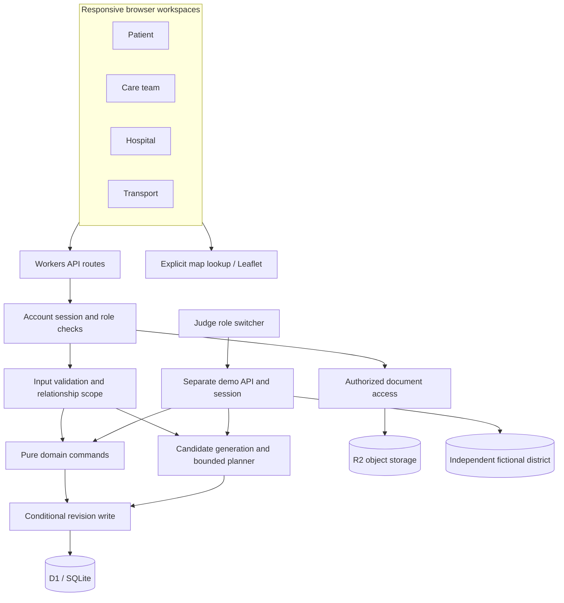
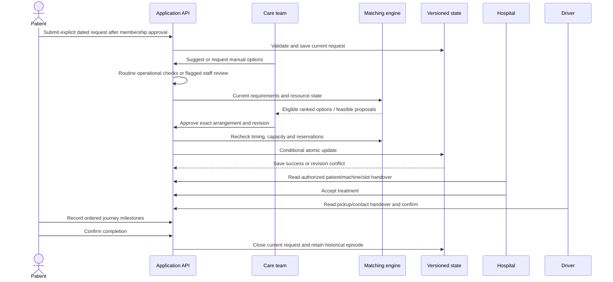

# CareRelay architecture

This describes the registered-account application and the separately isolated judge demonstration as of the final submission audit. It supersedes the earlier demo-only architecture description.

## System boundary

React/TypeScript pages use Next-style routes through Vinext/Vite. Cloudflare Workers execute server code. D1 holds accounts, sessions, document metadata and versioned district snapshots; R2 holds document bytes. Local Wrangler emulates these bindings without a Cloudflare account.

## Request-to-assignment sequence

Assignments appear in provider workspaces after admin approval. This is in-app handover, not an external SMS/EHR integration. Hospital acceptance and applicable transport confirmation remain explicit transitions.

## Responsibilities

| Module / route | Responsibility |
| --- | --- |
| `app/api/account`, `lib/accounts.ts` | Signup/login, sessions, onboarding, account status and first-operator provisioning. |
| `app/api/care-team`, `lib/care-team.ts` | Coordinator actions, request checks, options, proposals and approvals. |
| `app/api/district` | Authenticated scoped state and revision-checked domain actions. |
| Document routes | Upload metadata/bytes, ownership/review access, filename-preserving downloads and removal. |
| `lib/commands.ts` | Domain commands, resource updates, request changes and transition authorization. |
| `lib/request-validation.ts` | Current-request operational completeness and review requirements. |
| `lib/solver.ts` | Candidates, eligibility, ranking/search, staff/resource conflicts and plan validation. |
| `lib/service-time.ts` | IANA-local date/time conversion and absolute-time resource comparisons. |
| `lib/visibility.ts` | Response scope, current-episode access and transport field allowlist. |
| `lib/facility-machines.ts` | Machine inventory and dated slot registration/updates. |
| Shared inbox UI and domain rules | Authorized contacts, conversations, replies and unread state. |
| `app/api/demo`, `app/judge-demo` | Session-isolated fictional perspectives; no registered-account impersonation. |

## Persistence and competing writes

The prototype keeps each district as a keyed JSON snapshot with a revision. A write loads current state, validates the caller/input, applies a domain command and commits using `UPDATE ... WHERE revision = ?`. If another writer wins, the operation fails with a conflict rather than silently overwriting new reservations. The client must refresh and retry. A proposal/options preview does not itself book a slot.

This atomic snapshot design is suitable for a bounded prototype. It is not a claim of unlimited throughput or a normalized enterprise booking service. Representative multi-organization load testing and narrower resource transactions are future work.

## Eligibility, time and ranking

1. Registration/membership approval do not create a care request. Only explicit active requests enter matching.
2. Current date/timezone, duration/window, mobility/accessibility, transport kind, caregiver/seats, consent and budget must fit available resources.
3. Complete routine requests can pass operational checks automatically. Flagged clinical requirements need staff review; automatic checks never set clinical verification by themselves.
4. Real-provider readiness freshness uses elapsed wall-clock time. Missing, future or expired evidence fails. The fictional demo has an explicit simulated clock.
5. Machine/turnaround, staffing and vehicle overlaps compare absolute instants across dates/timezones. Invalid/nonexistent local-time intervals fail closed.
6. Individual options rank preferred-time fit before distance. Bulk search protects compatible coverage and priority before time fit, distance and fare. Approval revalidates the selection.
7. Valid commitments and underway destinations are protected. Completed historical episodes do not block a new request or become retroactively invalid because a provider later reports an outage.

Candidate generation is discrete and search is bounded. A search-limit plan is a validated feasible result, not proof of global optimality. Travel uses straight-line distance and conservative estimates rather than live road routing. Current prototype limits are documented in the final audit.

## Access and privacy

Passwords use salted PBKDF2; random session tokens are stored hashed. Routes enforce server-side authentication, role, entity and same-origin checks. Providers receive current patient/contact data only through active authorized current-episode relationships. Historical assignments do not confer access to an unrelated new request. Transport responses use an explicit allowlist, excluding internal operational fingerprints and unrelated clinical fields. Messaging also requires an authorized relationship; admin help has its own contact.

The judge password exposes only fictional demo state. Local loopback testing shortcuts are not production admin credentials. No private database, user upload, environment file or access token belongs in the repository.

These controls are not HIPAA certification. Before real clinical use, the operator needs appropriate privacy/retention policies, independent security review, clinical validation, document checks and a representative provider pilot.

## Future extension contracts

| Extension | Boundary to preserve |
| --- | --- |
| Verified route matrix | Preserve evidence timestamps, accessibility and explicit closures; never treat an estimate as a guarantee. |
| Hospital-system adapter | Record an external booking reference only after actual provider confirmation. |
| Recurring schedules | Add dated occurrences and verified conflict rules before pooling/multi-day behavior. |
| Other care pathways | Introduce domain-specific validated requirements rather than assuming dialysis rules fit every treatment. |
| Reminders and richer operations | Require opt-in contact channels and minimize shared data. |

[Final audit](FINAL-SUBMISSION-AUDIT-2026-10-24.md) · [Local setup](QUICKSTART.md) · [Contributing](../CONTRIBUTING.md)
