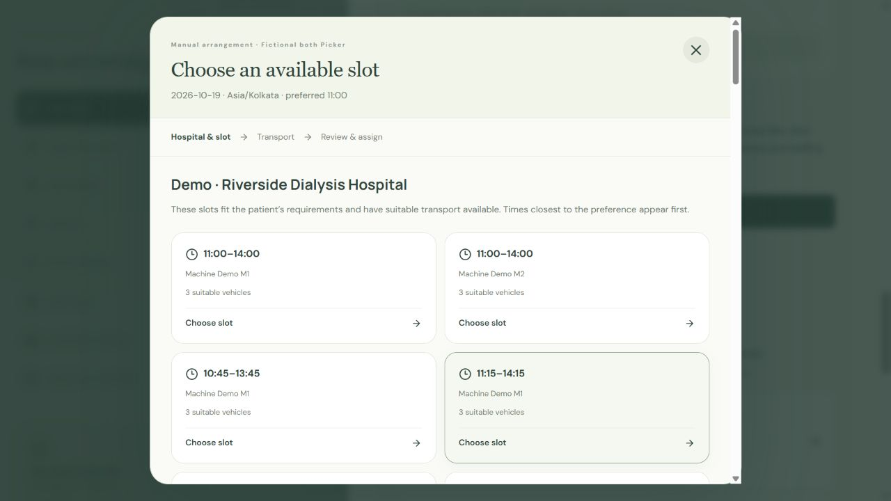
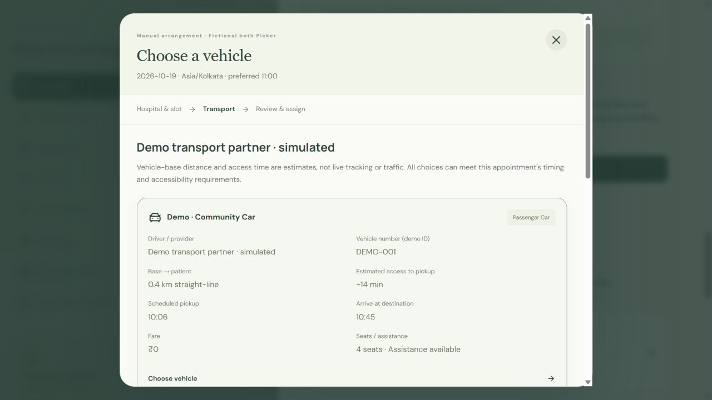
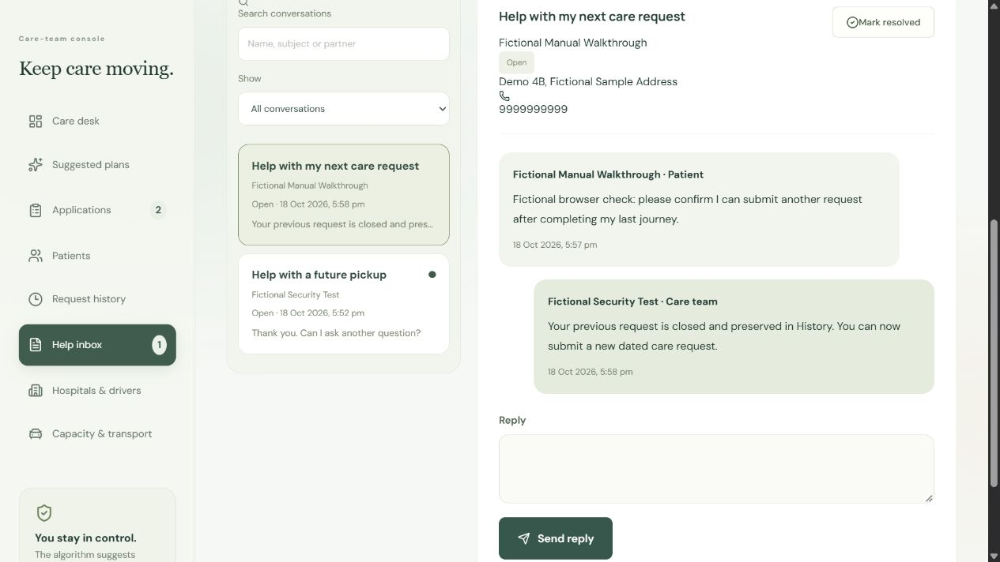
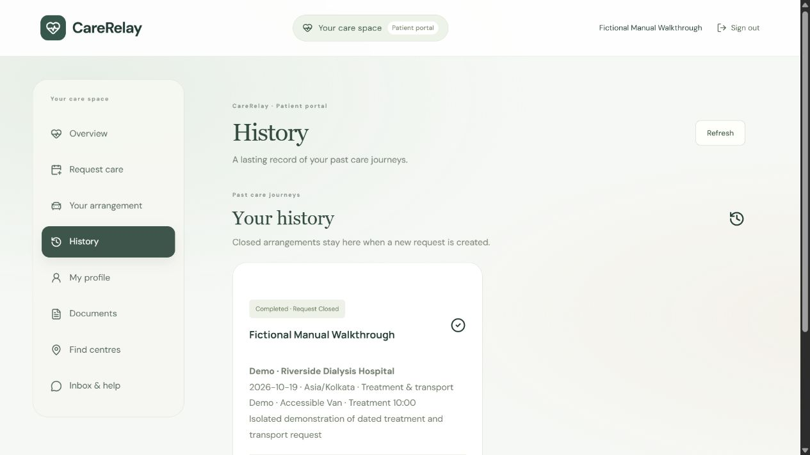

# CareRelay screenshot gallery

These captures use fictional patient/provider records in test/demo scenarios. They are functional prototype evidence, not real bookings or a claim of clinical outcomes. Some captures precede cosmetic refinements; source and the live walkthrough take precedence.

## Manual hospital and exact slot choice

Review compatible machine/slot choices before choosing transport. Preferred-time fit and distance order apply only among eligible options.

## Suitable transport choice

The prototype checks timing, mobility, caregiver seats and fare constraints. Estimates are not live traffic or vehicle tracking.

## Provider confirmations and arrangements

Admin approval and provider confirmation are distinct stages. A suggestion does not establish a real appointment.

## Conversation history

The shared inbox keeps authorized care conversations together. Unrelated providers cannot acquire current patient access from a closed historical episode.

## Completion and retained history

Completion moves the episode out of the active queue and retains history for subsequent requests.
